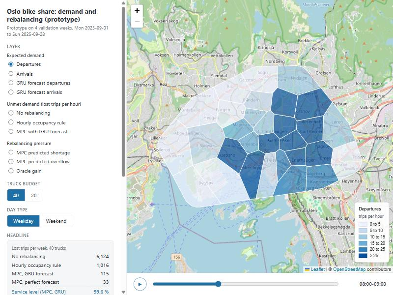

# Oslo bike-share: demand and rebalancing map

An interactive map of where bike-share demand is in Oslo, where trips are lost because a zone has no
bikes, and where trucks should move bikes, hour by hour. It is a planner-facing view of the course
project *Does Learning Add Value to Forecast-Based Bike-Share Rebalancing? Matched MLP and GNN Policies
in an Oslo Trip-Replay Simulator* (AMI23G, Högskolan Dalarna, 2026).

## Interactive map

**[View the map](https://satheendra.github.io/AMI23G_Oslo_Rebalancing_Map/)**



Open it in a browser. No server is needed; the page is one file with the data inside it.

## What the map shows

- **Zones.** The 276 Oslo Bysykkel stations grouped into 30 zones (k-means on station position). Each
  zone is drawn as a Voronoi cell around its centre, cut to the area the stations cover.
- **Hour slider** (bottom) and **Weekday / Weekend** toggle. Every value is a mean per hour of day over
  the weekdays (20 days) or weekend days (8 days) of the four validation weeks, 1 to 28 September 2025.
- **Truck budget.** How many bikes the trucks may move per hour (40 or 20).

| Layer group | Layers | Where the numbers come from |
|---|---|---|
| Expected demand | departures, arrivals, GRU forecast of each | the real trips; a GRU forecaster (mean of three seeds) |
| Unmet demand | lost trips per hour under no rebalancing, the hourly occupancy rule, and the MPC planner with the GRU forecast | replay of the real trips in the simulator |
| Rebalancing pressure | the MPC's predicted shortage and overflow per zone; the oracle gain | the MPC plan each hour; lost trips with the GRU forecast minus lost trips with a perfect next-hour forecast |
| Trucks versus service level | lost trips per week against the truck budget (10 to 80) for the hourly rule, the old LP, the MPC, and the MPC with a perfect forecast | the regime map of the project; click a budget to update the headline |

A *lost trip* is a departure from a zone that has no bike at that moment. *MPC* is model-predictive
control: every hour the planner solves a small optimisation over the next six hours, carries out the
first hour's moves, and re-plans.

## Headline numbers (lost trips per week, validation weeks, budget 40)

| Controller | Lost trips per week |
|---|---|
| No rebalancing | 6124 |
| Hourly occupancy rule | 1016 |
| MPC with GRU forecast | 115 |
| MPC with perfect next-hour forecast | 33 |

## How it was made

- `src/build_data.py` reads the project's prepared data (zones, hourly panel, saved forecasts, result
  tables), runs the trip-replay simulator over the four validation weeks for each controller and
  budget, averages lost trips and the MPC plan slacks per zone, hour of day and day type, and writes
  `data/map_data.json` and `data/layers.geojson`.
- `src/build_html.py` pastes `map_data.json` into `src/template.html` and writes `docs/index.html`.
- `data/layers.geojson` holds the 30 polygons with one property per layer, day type and hour (for
  example `lost_mpc_b40_wd_08`), so the layers can be loaded into QGIS or another map tool.
- `data/SCHEMA.md` describes the data layout.

The simulator and planner code are in the course submission; `build_data.py` imports them from there.
The map was built on the project's v2 simulator and MPC runs (same stations, zones and trips as the
submitted v3 study).

## Scope and caveats

- Oslo only, four validation weeks in September 2025; the 2026 test season is not used.
- Zone borders are drawn from zone centres, not from station positions, so they are approximate.
- Lost trips per zone-hour are small for the MPC (often under 1 per hour); the colour scale is fixed
  per layer so hours can be compared, which makes most MPC cells look pale on purpose.
- Four weeks only; week-to-week spread is large.

## Data sources

- **Trips and stations:** Oslo Bysykkel open data (Norwegian Licence for Open Government Data, NLOD 2.0).
- **Basemap:** OpenStreetMap (ODbL 1.0). Map library: Leaflet 1.9.4.

## Repository structure

```
docs/
  index.html                                  the interactive map (self-contained)
  screenshot_departures_weekday_08.jpg        two screenshots
  screenshot_lost_norebalancing_weekday_17.jpg
data/
  layers.geojson                              zone polygons with every layer value
  map_data.json                               the data embedded in the page
  SCHEMA.md                                   layout of the two data files
src/
  build_data.py                               runs the simulator and writes the data files
  build_html.py                               builds docs/index.html from the template
  template.html                               the page with a data placeholder
  make_fixture.py                             fake data for testing the page
```

## Tools

Python 3.13 (numpy, pandas, scipy, shapely, numba) · Leaflet.js · OpenStreetMap
