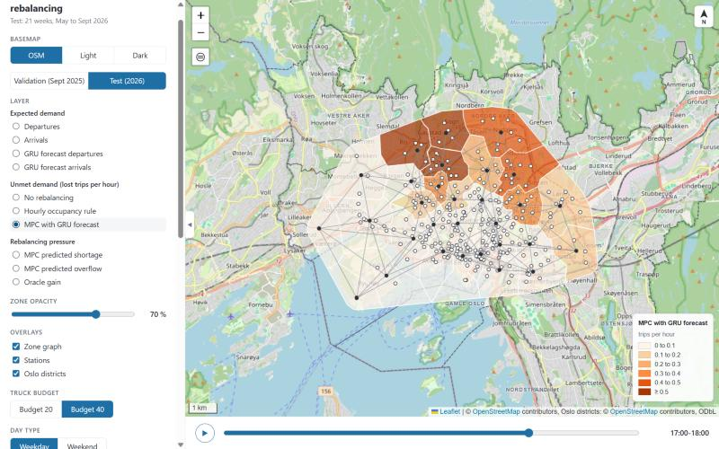

# Oslo bike-share: demand and rebalancing map

An interactive map of where bike-share demand is in Oslo, where trips are lost because a zone has no
bikes, and where trucks should move bikes, hour by hour. It is a planner-facing view of the course
project *Does Learning Add Value to Forecast-Based Bike-Share Rebalancing? Matched MLP and GNN Policies
in an Oslo Trip-Replay Simulator* (AMI23G, Högskolan Dalarna, 2026). The numbers come from the same
simulator, planner and result tables as the paper.

## Interactive map

**[View the map](https://satheendra.github.io/oslo-rebalancing-map/)**



Open it in a browser. No server is needed; the page is one file with the data inside it.

## What the map shows

- **Zones and stations.** The 276 Oslo Bysykkel stations grouped into 30 zones (k-means on station
  position). Each zone is the union of the Voronoi cells of its stations, cut to the area the stations
  cover. Three overlays can be switched on or off: the station points, the zone graph (103 links
  between neighbouring zones) that the GNN policy and the GNN forecaster use, and the outlines of
  Oslo's official city districts (bydeler, from OpenStreetMap) for orientation.
- **Map tools.** Basemap switch (OpenStreetMap, light grey, dark grey), a zone opacity slider, a
  north arrow, a scale bar, a fit-to-zones button, and a collapsible panel.
- **Period.** *Validation* is the four weeks of September 2025 used to choose settings. *Test* is the
  21 weeks of May to September 2026 that the paper reports. Every map value is a mean per hour of day
  over the weekdays or weekend days of the chosen period.
- **Hour slider** (bottom), **Weekday / Weekend** toggle, and **truck budget** (bikes the trucks may
  move per hour: 40 or 20).

| Layer group | Layers | Where the numbers come from |
|---|---|---|
| Expected demand | departures, arrivals, GRU forecast of each | the real trips; the GRU forecaster (mean of three seeds) that fed the planner |
| Unmet demand | lost trips per hour under no rebalancing, the hourly occupancy rule, and the full MPC planner | replay of the real trips in the simulator |
| Rebalancing pressure | the MPC's predicted shortage and overflow per zone; the oracle gain | the MPC plan each hour; lost trips with the GRU forecast minus lost trips with a perfect next-hour forecast |
| Controller ladder (chart) | lost trips per week for no rebalancing, the hourly rule, full MPC, the PPO policies (MLP and GNN encoders) and the MPC with a perfect forecast, at budget 20 or 40 | the paper's table of controller means on the test weeks; the reference runs on the validation weeks |

A *lost trip* is a departure from a zone that has no bike at that moment. *MPC* is model-predictive
control: every hour the planner solves a small optimisation over the next six hours, carries out the
first hour's moves, and re-plans. *PPO* is the reinforcement-learning method that trained a policy to
choose among candidate actions for part of the truck budget, on top of the MPC plan.

## Headline numbers (lost trips per week, test weeks 2026, budget 40)

| Controller | Lost trips per week |
|---|---|
| No rebalancing | 6819 |
| Hourly occupancy rule | 2597 |
| Full MPC with GRU forecast | 522 |
| PPO, MLP policy (mean of 3 seeds) | 331 |
| PPO, GNN policy (mean of 3 seeds) | 302 |
| MPC with perfect next-hour forecast | 229 |

## How it was made

- `src/build_data.py` reads the project's prepared data (zones, stations, hourly panel, saved forecasts,
  result tables), runs the trip-replay simulator over the validation and test weeks for each controller
  and budget, averages lost trips and the MPC plan slacks per zone, hour of day and day type, and writes
  `data/map_data.json` and `data/layers.geojson`. It imports the simulator and planner from the course
  submission (`OSLO_PROJECT_DIR` points at that folder).
- `src/build_html.py` pastes `map_data.json` into `src/template.html` and writes `docs/index.html`.
- `data/layers.geojson` holds the 30 polygons with one property per period, layer, day type and hour
  (for example `test_lost_mpc_b40_wd_08`), so the layers can be loaded into QGIS or another map tool.
- `data/SCHEMA.md` describes the data layout.

## Scope and caveats

- Oslo only. The PPO policies are not drawn on the map yet; they appear in the ladder chart only.
- Lost trips per zone-hour are small for the MPC (often under 1 per hour); the colour scale is fixed
  per layer across both periods so hours and periods can be compared, which makes most MPC cells look
  pale on purpose.
- Validation is four weeks, so its week-to-week spread is large; the test period is 21 weeks.

## Data sources

- **Trips and stations:** Oslo Bysykkel open data (Norwegian Licence for Open Government Data, NLOD 2.0).
- **District outlines:** OpenStreetMap contributors (ODbL 1.0), via the Overpass API, simplified.
- **Basemaps:** OpenStreetMap (ODbL 1.0); light and dark grey canvases by Esri. Map library: Leaflet 1.9.4.

## Repository structure

```
docs/
  index.html                                  the interactive map (self-contained)
  screenshot_*.jpg                            screenshots
data/
  layers.geojson                              zone polygons with every layer value
  map_data.json                               the data embedded in the page
  oslo_districts.geojson                      Oslo district outlines (OpenStreetMap)
  SCHEMA.md                                   layout of the two data files
src/
  build_data.py                               runs the simulator and writes the data files
  build_html.py                               builds docs/index.html from the template
  template.html                               the page with a data placeholder
  make_fixture.py                             fake data for testing the page
```

## Tools

Python 3.13 (numpy, pandas, scipy, shapely, numba) · Leaflet.js · OpenStreetMap
